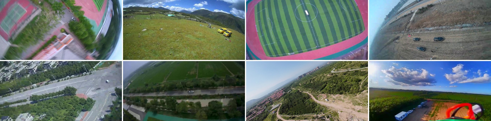
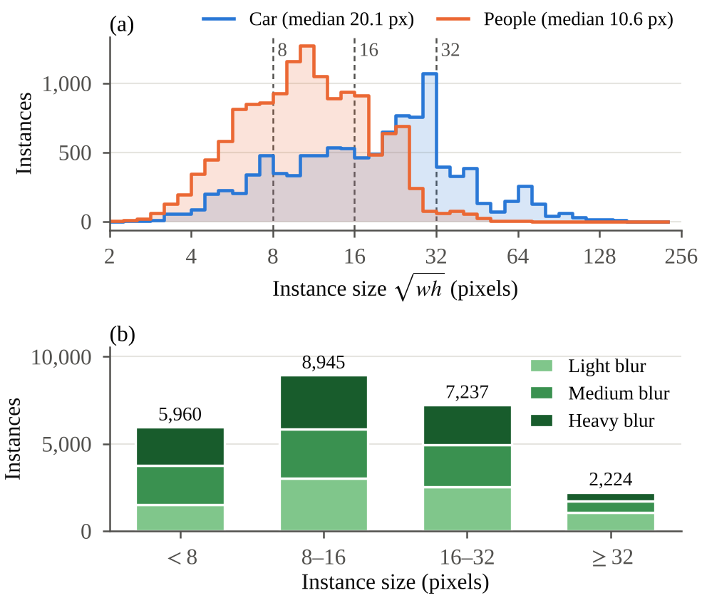

# FlapVis: A Small-Target Detection Dataset for Flapping-Wing Flying Robots

*A real-flight object detection dataset captured by a flapping-wing flying robot (FWFR).*

This repository hosts a **representative subset** of **FlapVis**, a self-collected object
detection dataset acquired by our flapping-wing flying robot during real flights. FlapVis
covers diverse low-altitude scenes and is dominated by small targets with weak appearance
cues against cluttered backgrounds. Because the onboard camera moves with the flapping
wings and the changing flight attitude, the images also exhibit camera shake, varied
viewpoints, and target scales that change across the image.

## Highlights

### Captured by a real flapping-wing platform

All images are acquired during real flights by **USTB-Hawk**, a self-developed purely
flapping-wing flying robot, and therefore reflect the imaging conditions of flapping-wing
aerial perception.



*Representative samples. Top row, from left to right: campus area with flapping-induced
blur, highland meadow, sports field, and construction site. Bottom row: urban
intersection, canal road, hilly scrubland, and farmland with part of the airframe in the
field of view.*

### Small targets in diverse scenes

The full dataset contains **7,049 images** from **36 flight sequences** recorded at
**11 sites**, covering eight scene types: campus area, highland meadow, sports field,
construction site, urban area, canal road, hilly scrubland, and farmland. The sequences
span nadir to oblique viewing angles, different flight altitudes, and different
illumination conditions, and include flapping-induced camera shake, frequent attitude
changes, wide-angle lens distortion, and occasional occlusion by the airframe.

Small targets dominate FlapVis. At the 640 × 640 network input, the median target size is
12.9 pixels, with class-wise medians of 20.1 pixels for cars and 10.6 pixels for people,
and 61.2% and 90.9% of the targets are smaller than 16 and 32 pixels, respectively. Each
target is also assigned a blur level of light, medium, or heavy by a no-reference blur
metric computed on its local region, and blurred targets appear in all size groups.

<p align="center">
  
</p>

*Dataset statistics. (a) Distribution of target sizes for each category, measured as √wh
at the 640 × 640 network input, with the 8-, 16-, and 32-pixel boundaries marked.
(b) Number of targets in each size group and blur level.*

### Manually annotated and cross-reviewed

All visible cars and people are manually annotated with bounding boxes, and every
annotation is reviewed by multiple annotators to ensure accuracy and consistency.

## Dataset Overview

| Property                 | Full dataset                           | This subset |
| ------------------------ | -------------------------------------- | ----------- |
| Platform                 | USTB-Hawk (flapping-wing flying robot) | same        |
| Images                   | 7,049                                  | 150         |
| Annotated instances      | 24,366 (10,552 car / 13,814 people)    | 570         |
| Flight sequences / sites | 36 / 11                                | —           |
| Categories               | 2 (`car`, `people`)                    | same        |
| Annotation format        | YOLO (`.txt`)                          | YOLO (`.txt`) and COCO (`.json`) |

> **Note:** This repository provides a representative subset of FlapVis for verification.
> The complete dataset, split into 4,917, 728, and 1,404 images for training, validation,
> and testing, is still being organized and will be released together with the associated
> paper.

## Categories

| id   | name   |
| ---- | ------ |
| 0    | car    |
| 1    | people |

## Data Collection and Splitting

The raw videos are recorded by the onboard camera of USTB-Hawk during real flights, and
frames are sampled from each flight sequence. Since adjacent frames are highly redundant,
the dataset is split at the sequence level: sequences with highly similar views are
grouped into the same split, every recording site appears in the training set, and no
validation or test image has a near-duplicate in the training set. The images in this
subset are selected by stratified sampling across scene groups.

## Data Structure

The subset is organized as follows:

```
${FlapVis_ROOT}
 -- images
     |-- <frame_name>.jpg
     |-- <frame_name>.jpg
     ...
 -- labels
     |-- <frame_name>.txt
     |-- <frame_name>.txt
     ...
 -- annotations.json     # COCO-format annotations
```

Each label file shares the same base name as its corresponding image.

## Annotation Format

Each image has a YOLO-format label file (`labels/<name>.txt`), in which each line
describes one object as:

```
<class_id> <x_center> <y_center> <width> <height>
```

All coordinates are normalized to `[0, 1]` by the image width and height. A COCO-format
file (`annotations.json`) with the `images`, `annotations`, and `categories` fields is
also provided for convenience.

## Data Availability

The complete FlapVis dataset is currently being organized and will be released together
with the associated paper. Researchers interested in the full dataset may contact the
corresponding author by email.
