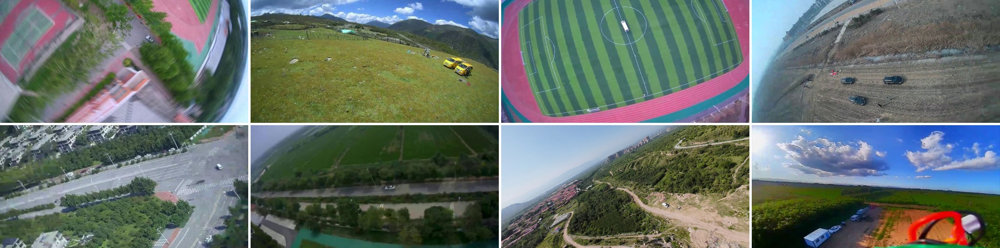

# FlapVis: A Small-Target Detection Dataset for Flapping-Wing Flying Robots

*An aerial small-target detection dataset captured by a flapping-wing flying robot (FWFR) during real flight.*

This repository hosts a **representative subset** of the **FlapVis** dataset, a
self-collected aerial small-target detection dataset acquired by a flapping-wing flying
robot (FWFR). Unlike conventional aerial datasets collected by relatively stable
rotary-wing UAVs, FlapVis is captured during actual flapping-wing flight, where the
onboard camera is affected by image jitter and unstable imaging conditions. As a result,
the dataset naturally contains typical visual degradation characteristics of FWFRs, such
as motion blur and weak target textures.

## Highlights

### Captured by a real flapping-wing platform

All images are acquired by a self-developed FWFR named **USTB-Hawk** during real flight,
rather than by rotary-wing UAVs or simulation. The data therefore reflects the genuine
imaging conditions of onboard flapping-wing perception.



*Representative samples. Top row, from left to right: campus area under severe
jitter-induced blur, highland meadow, sports field, and construction site. Bottom row:
urban intersection, canal road, hilly scrubland, and farmland with parts of the airframe
entering the field of view.*

### Motion-degraded, small-target, diverse scenes

The full dataset contains **7,049 images** from **36 flight sequences** recorded at
**11 sites**, covering eight scene types: campus area, highland meadow, sports field,
construction site, urban area, canal road, hilly scrubland, and farmland. The sequences
span nadir to oblique viewing angles, various flight altitudes, and different
illumination conditions, and exhibit flapping-induced motion blur, frequent attitude
changes, wide-angle lens distortion, and occasional occlusion by the airframe.

Small targets dominate FlapVis: at the 640 × 640 network input, the median instance
size is about 13 pixels, and more than 90% of the instances are smaller than
32 × 32 pixels.

### Manually annotated and cross-reviewed

All visible `car` and `people` instances are manually annotated with bounding boxes.
Every annotation has been reviewed and verified by multiple annotators to ensure
labeling accuracy and consistency.

## Dataset Overview

| Property                 | Full dataset                           | This subset |
| ------------------------ | -------------------------------------- | ----------- |
| Platform                 | USTB-Hawk (flapping-wing flying robot) | same        |
| Images                   | 7,049                                  | 150         |
| Annotated instances      | 24,366 (10,552 car / 13,814 people)    | 570         |
| Flight sequences / sites | 36 / 11                                | —           |
| Categories               | 2 (`car`, `people`)                    | same        |
| Annotation format        | YOLO (`.txt`)                          | YOLO (`.txt`) and COCO (`.json`) |

> **Note:** This repository provides only a representative subset of FlapVis for
> verification purposes. The complete dataset (7,049 images, split 4,917 / 728 / 1,404
> for train / val / test) will be made publicly available upon publication of the
> associated paper.

## Categories

| id   | name   |
| ---- | ------ |
| 0    | car    |
| 1    | people |

## Data Collection and Splitting

The raw footage is recorded by the onboard camera of USTB-Hawk during actual
flapping-wing flight, and frames are sampled from each flight sequence. Because adjacent
frames are highly redundant, the dataset is split by sequence rather than by frame:
sequences with highly similar views are grouped and assigned to the same subset, every
recording site appears in the training set, and no validation or test image has a
near-duplicate in the training set. The samples in this subset are selected by
stratified sampling across scene groups.

## Data Structure

The subset is organized as follows:

   ```
${FlapVis_ROOT}
 -- images
     |-- <frame_name>.jpg
     |-- <frame_name>.jpg
     ...
 -- labels
     |-- <frame_name>.txt
     |-- <frame_name>.txt
     ...
 -- annotations.json     # COCO-format annotations
   ```

Each label file shares the same base name as its corresponding image.

## Annotation Format

Each image has a corresponding YOLO-format label file (`labels/<name>.txt`).
Each line describes one object as:

   ```
<class_id> <x_center> <y_center> <width> <height>
   ```

where all coordinates are normalized to `[0, 1]` with respect to the image size.
A COCO-format file (`annotations.json`) containing the `images`, `annotations`, and
`categories` fields is also provided for convenience.

## Data Availability

The complete FlapVis dataset will be released upon publication of the associated paper.
Researchers interested in the full dataset may request access from the corresponding
author via email.
